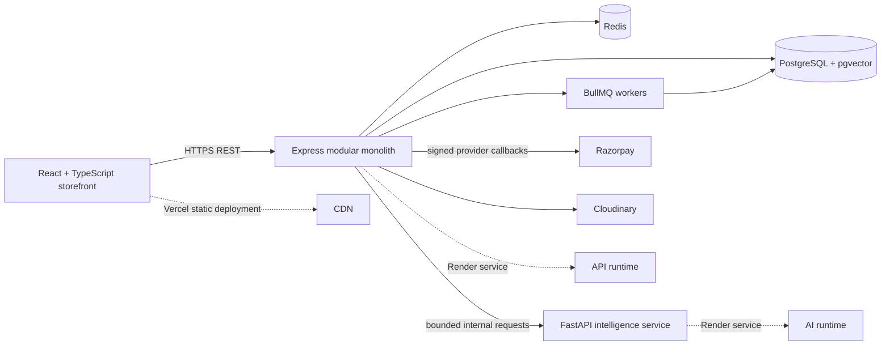

# ShopSmart architecture

## Current state and target

The current runnable milestone is a Vite SPA backed by an Express/Prisma API and PostgreSQL catalog, with customer identity and database-backed role checks. The architecture below remains the target deployment shape; unfinished integrations are called out in the implementation checklist.

## Boundaries

- **Web:** React/TypeScript/Vite; presentation and client-side interaction only. Never trust client prices, identity, inventory, role, or payment status.
- **Commerce API:** Express modules for identity, catalog, seller operations, cart/checkout, orders/payments, reviews/community, circular commerce, and administration. Keep domain transactions in the API; expose versioned REST and OpenAPI contracts. Authentication uses scrypt password hashes, short-lived JWTs bound to revocable database sessions, rotating opaque refresh cookies, and current-database role/ownership checks.
- **Data:** PostgreSQL is the source of truth. Prisma models and migrations define constraints and indexes. Use database transactions and row-level reservation/conditional updates for inventory; do not rely on an in-process lock.
- **AI:** FastAPI service is separately deployable. It returns attributed, bounded insights and ranked product identifiers; the commerce API owns authorization and catalog truth. Start with measured baselines before adding models.
- **Async:** Redis/BullMQ for non-critical notifications, media processing, analytics materialization, and forecasting. Payment webhooks and order state transitions require durable idempotency, not fire-and-forget jobs.
- **External providers:** Razorpay handles payment processing and sends authenticated webhooks; card data never enters ShopSmart. Cloudinary receives server-authorized uploads after type/size checks.

## Data and trust rules

1. Model a customer order as a parent order and one seller order per fulfilling seller.
2. Keep money in integer paise and store a currency code; calculate prices and commissions on the server.
3. Inventory reservations are expiring, transactional records. A paid webhook can confirm only a matching, pending, idempotent payment.
4. Every user-facing write derives the actor and permissions from verified server-side identity; seller access is scoped to seller-owned records.
   Public registration always assigns CUSTOMER. Seller, seller-staff, moderator, support-agent, admin, and super-admin roles are only read from the database after authenticating the session.
   Seller applications are separate from privileged roles; approval atomically records the decision, creates/activates the owned seller profile, and grants SELLER. Seller dashboard access additionally requires an approved application and verified, unsuspended seller status. Public storefront DTOs omit private application/address data.
   Product listing lifecycle and administrator moderation are separate states. Public catalog reads require a published product with APPROVED moderation and an active verified seller. Seller product writes scope by the authenticated user; seller inputs cannot set moderation metadata. Initial positive variant stock and its opening adjustment are inserted in one transaction. Inventory adjustment operations must lock/conditionally update the variant and insert the corresponding ledger entry in the same transaction.
5. Reviews can be labelled verified purchase only after joining completed order items to the authenticated reviewer.
6. AI recommendations are advisory. Persist provenance/version and evaluation metrics before representing model outputs as trusted evidence.
7. Secrets are environment-managed; redact authorization headers, payment payload secrets, and personal data from logs.
   Email verification and password-reset links contain opaque one-time tokens; only token hashes are persisted.

## Early design decisions

- Start as a modular monolith to keep transactional commerce simple; extract the Python service only for model and retrieval isolation.
- Build the storefront before the integration-heavy checkout so interactions and UI direction can be reviewed without fake payment behavior.
- Keep demo data explicitly labelled and separate from any future production database seed.
- Prefer server-side pagination and bounded query validation; add pgvector only with a real embedding workflow and measured retrieval evaluation.
